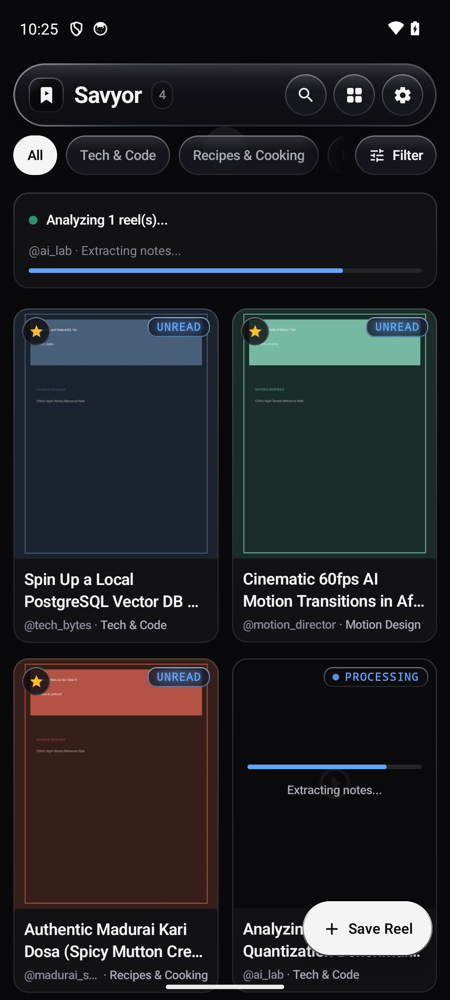
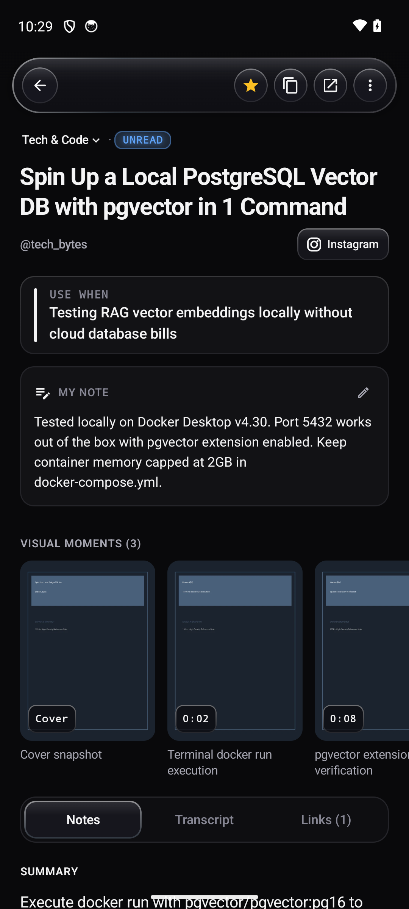
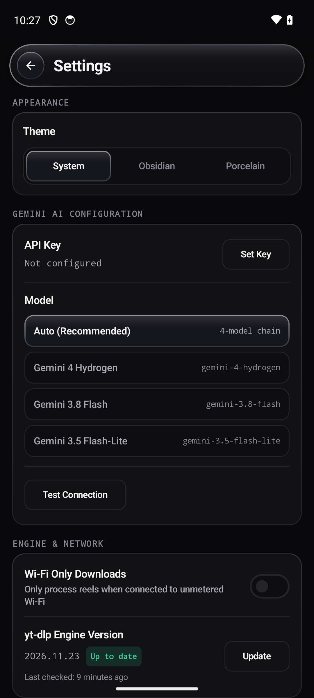

# Savyor

**Turn Instagram Reels into searchable, permanent notes with 0 MB of video stored.**

Savyor is a native Android app that takes any Instagram Reel you share, extracts the key substance, summary, verbatim code and commands, recipes, steps, links, English and native transcripts, and key-moment snapshots and immediately deletes the temporary video file.

## Screenshots

<table>
  <tr>
    <td align="center"></td>
    <td align="center"></td>
    <td align="center"></td>
  </tr>
  <tr>
    <td align="center">Home (Obsidian)</td>
    <td align="center">Reel Detail</td>
    <td align="center">Settings</td>
  </tr>
</table>

## What It Does

- **0 MB permanent video storage:** Downloads the Reel temporarily, extracts notes and compressed WebP key frames, then deletes the `.mp4` automatically.
- **Structured AI extraction:** Uses Google Gemini (`gemini-4-hydrogen` with automatic fallback to `gemini-3.8-flash` and `gemini-3.5-flash-lite`) to extract practical **Use When** cues, takeaways, code blocks, recipes, links, and translated transcripts.
- **Offline full-text search and organization:** Search across titles, notes, transcripts, creators, and personal annotations with custom topics, status filters (`Unread`, `Reviewed`, `Tried`, `Archived`), date filters, and Grid, List, or Compact views.
- **Private and local-first:** Everything stays in a local SQLite database on your phone with an encrypted API key and one-tap `.zip` backup and restore to Google Drive or device storage.

## How to Set Up

1. **Install the APK**
   - Download the APK from the [Releases](https://github.com/k4bi1an/Savyor/releases) page (most modern Android phones use `arm64-v8a`).
   - Open the APK on your phone and allow installation from your browser or file manager if prompted.

2. **Get a Free Gemini API Key**
   - Go to [Google AI Studio](https://aistudio.google.com/apikey) and sign in with your Google account.
   - Click **Create API Key** and copy it.

3. **Connect Savyor**
   - Open **Savyor > Settings > Gemini AI Configuration > Set Key**, paste your key, and save.
   - Tap **Test Connection** to confirm it connects (the default **Auto** model chain handles rate limits automatically).

4. **Enable Background Processing (Recommended on Samsung / One UI)**
   - In **Savyor > Settings > Device Optimization**, tap **Open App Settings** and set Battery usage to **Unrestricted** so Reels finish analyzing even when your screen is off.

## Quick Guide: How to Use

- **Save a Reel:** In Instagram, tap **Share > Savyor** (or copy the Reel link and tap **+ Save Reel** in Savyor). A progress bar tracks downloading, note extraction, and frame capture in the background.
- **Read and Review:** Tap any saved card to view its **Use When** cue, swipeable **Visual Moments** (tap any frame to zoom), and the **Notes**, **Transcript**, and **Links** tabs.
- **Add Your Own Notes and Star Favorites:** Tap **My Note** inside any Reel to jot down personal reminders (included automatically when you copy or share Markdown), or tap the **Star** icon to favorite it.
- **Open Original Reel:** Tap the **Instagram** button inside a Reel's detail view to jump straight back to the original post in Instagram.
- **Organize and Filter:** Scroll to the end of the topic bar and tap **+ Topic** to create custom categories, or tap **Filter** to filter by status, starred items, date range, or sort order.
- **Switch Theme:** Go to **Settings > Appearance** to switch between **System**, **Obsidian** (dark), and **Porcelain** (light).
- **Backup and Restore:** Go to **Settings > Backup & Restore** to export your entire library (database and snapshots) as a `.zip` directly to Google Drive or phone storage, and restore it anytime on a new device.

Building from source

1. Open the `android/` directory in Android Studio (JDK 17, Android SDK 34).
2. Run `./gradlew assembleDebug` (or `gradlew.bat assembleDebug` on Windows).
3. For signed release builds, configure your keystore in `android/local.properties` and run `./gradlew assembleRelease`.

