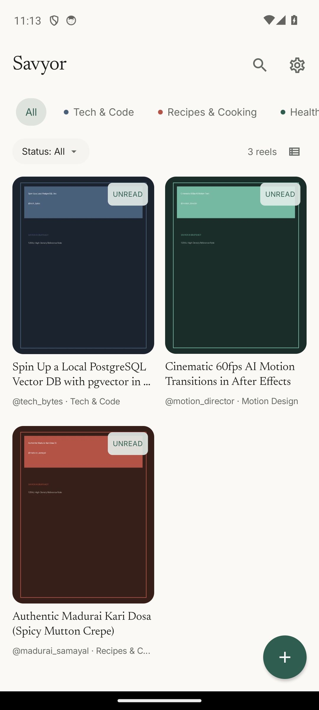
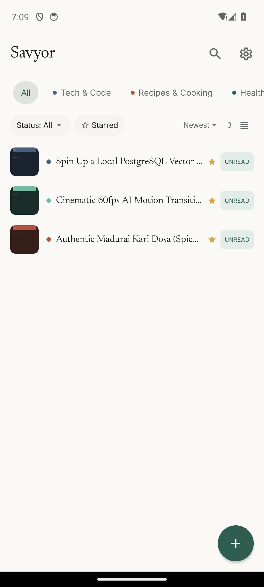
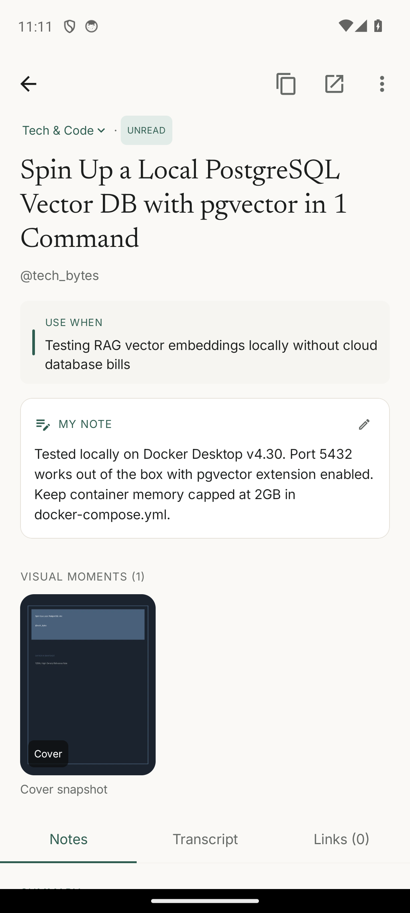
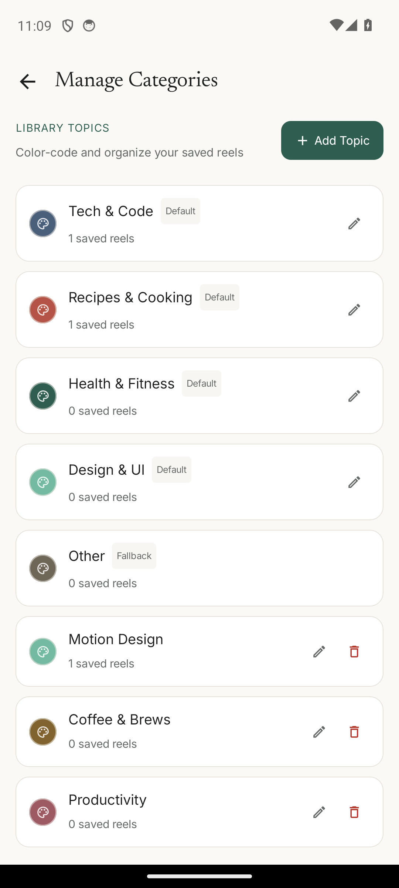

# Savyor — Save the reel. Keep the idea.

**Savyor** is a native Kotlin + Jetpack Compose Android app that turns short-form Instagram Reels into permanent, searchable, self-contained English knowledge notes — while deleting the downloaded video file immediately after analysis so permanent video storage stays at **0 MB**.

---

## Key Features

- **Share-Sheet Capture:** Share any Instagram Reel directly to **Savyor** from Instagram's Share Sheet (or paste a link). Queued in the background via `WorkManager` with optional Wi-Fi-only constraints.
- **On-Device Stream Fetch & Self-Healing:** Uses `youtubedl-android` (no FFmpeg) to fetch progressive MP4 streams (`<=720p`) into app cache. Includes a 7-day Wi-Fi startup update check and a 12-hour self-healing update + retry if a download fails.
- **Multimodal AI Extraction (`gemini-3.5-flash`):** Analyzes both video frames and audio/captions via the Google AI Studio Gemini Files API to extract:
  - Anti-clickbait summaries and concise **"Use When"** cues
  - Verbatim code snippets, CLI commands, recipes (ingredients + steps), workouts, and listicles
  - Full English translation for non-English/multilingual reels (while preserving the original native transcript)
  - Caveats, sponsor/satire notes, and extracted links/resources
- **Key-Moment WebP Frames in Notes:** Extracts a cover thumbnail and 2–4 key-moment **WebP frames** from the reel via Android `MediaMetadataRetriever` (`FrameExtractor`) and embeds them directly in each note's **Visual Moments** carousel and zoomable fullscreen lightbox before deleting the temporary `.mp4`.
- **Visual Memory Search (`visual_memory`):** Indexes 1–2 sentence visual appearance cues (clothing, setting, lighting, props) in SQLite FTS4/FTS5 so you can find a reel even if you only remember what the video looked like.
- **Personal "My Note" & Starred Favorites:** Add inline personal observations (also FTS-indexed and included in Markdown exports/shares), star (`★`) favorites, and filter with a 1-tap `Starred` pill.
- **Library Organization & Layouts:** Custom color-coded categories (with safe reassignment to `"Other"` on delete and few-shot prompt adaptation), sort (`Newest`, `Oldest`, `Title A–Z`), and 3-way view cycling (`Grid` → `List` → `Compact`).
- **Share & Copy Markdown:** One-tap Copy Markdown or Android `ACTION_SEND` Share Note for WhatsApp, Samsung Notes, or Notion.
- **1-Tap Backup & Restore (`.zip`):** Storage Access Framework (SAF) export to Google Drive or local storage (checkpoints SQLite WAL and archives `savyor.db` + WebP snapshots) and safe restore with Zip Slip path-traversal protection.

---

## Screenshots

See the full 14-page Light & Dark UI showcase in [Savyor_Android_UI_Screenshots.pdf](docs/android/screenshots/Savyor_Android_UI_Screenshots.pdf) or browse [docs/android/screenshots/](docs/android/screenshots/).

| Library (Grid) | Library (Compact) | Reel Detail + Key Frames & My Note | Manage Categories |
| :---: | :---: | :---: | :---: |
|  |  |  |  |

---

## Project Structure

```text
├── android/                        # Native Kotlin + Jetpack Compose Android app
│   ├── app/src/main/java/com/savyor/app/
│   │   ├── data/local/             # Room DB (v3, MIGRATION_1_2 -> MIGRATION_2_3), FTS, SAF Backup, LRU cache
│   │   ├── data/remote/            # YtDlpEngine, GeminiFilesClient, GeminiPromptBuilder, FrameExtractor
│   │   ├── domain/model/           # GeminiModelSchema
│   │   ├── ui/screens/             # Library, ReelDetail, ManageCategories, Settings
│   │   └── work/                   # WorkManagerScheduler, ProcessReelWorker
│   ├── app/src/test/               # JVM unit tests (18 tests)
│   └── app/src/androidTest/        # Emulator instrumented tests (13 tests)
├── docs/android/screenshots/       # Light/Dark screenshots & consolidated PDF
└── scripts/                        # Screenshot PDF generator & emulator seed script
```

---

## Build & Test

1. Configure your Android SDK and optional release keystore in git-ignored `android/local.properties`:
   ```properties
   sdk.dir=C\:\\Path\\To\\Android\\Sdk
   RELEASE_STORE_FILE=C\:\\Path\\To\\savyor-release.jks
   RELEASE_STORE_PASSWORD=your_store_password
   RELEASE_KEY_ALIAS=savyor
   RELEASE_KEY_PASSWORD=your_key_password
   ```
2. Run JVM unit tests & instrumented tests:
   ```powershell
   .\android\gradlew.bat -p android testDebugUnitTest
   .\android\gradlew.bat -p android connectedDebugAndroidTest
   ```
3. Build the minified R8 Release APK (`arm64-v8a` & `x86_64` ABI splits):
   ```powershell
   .\android\gradlew.bat -p android assembleRelease
   ```
   Output: `android/app/build/outputs/apk/release/app-arm64-v8a-release.apk` (~21.4 MB).
